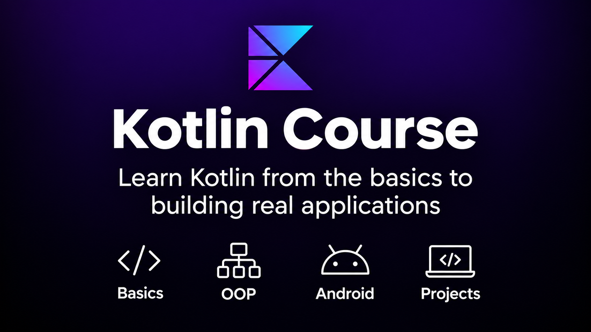

```markdown
# Kotlin Course / Курс Kotlin / Курс Kotlin

[English] · [🇷Русский] · [🇺Українська]

Короткий опис · Краткое описание · Short description:

> Навчальний курс з Kotlin з автоматичною перевіркою тестів через IntelliJ IDEA, GitHub Actions.
> Учебный курс по Kotlin с автоматической проверкой тестов через IntelliJ IDEA, GitHub Actions.
> A hands-on Kotlin course with automated test checking via IntelliJ IDEA, GitHub Actions.


| Branch | Status |
|:---|:---:|
| **main** |  |
| **dev** |  |

## English
### About
This is an open Kotlin learning course. Each task is a function with a `TODO()` stub and a ready-made JUnit 5 test. Your goal is to implement the function so that all tests pass.
Tests run automatically on every push and pull request via **GitHub Actions**.
### Requirements
- JDK 22 (or 17+)
- Git
- IntelliJ IDEA (recommended) or any IDE with Kotlin support

### How to start

1. **Fork** this repository (button "Fork" in the top-right corner).
2. **Clone** your fork:
   ```bash
   git clone git@github.com:<your-username>/KotlinCource.git
   cd KotlinCource
   ```
3. Open the project in IntelliJ IDEA (it will pick up Gradle automatically).
4. Run the tests to see the current state:
   ```bash
   ./gradlew test
   ```
   Tests will fail with `NotImplementedError` — that's expected, the tasks are not solved yet.

### How to solve a task

1. Open `src/main/kotlin/com/selfcode/com/tasks/TaskN.kt`.
2. Replace `TODO("...")` with a real implementation.
3. Run tests locally:
   ```bash
   ./gradlew test
   ```
4. Commit and push:
   ```bash
   git add .
   git commit -m "Solve Task N"
   git push
   ```
5. Check the **Actions** tab in your fork — a green check ✅ means all tests pass.

### Submitting your solution

1. Make sure all tests pass in your fork (`Actions` → green ✅).
2. Open a **Pull Request** to the original repository.
3. Wait for review — the maintainer will check your code and CI status.

### Project structure

```
.
├── build.gradle.kts              # Gradle build config
├── settings.gradle.kts
├── gradle/                       # Gradle wrapper
├── .github/workflows/test.yml    # CI: runs tests on push/PR
└── src/
    ├── main/kotlin/com/selfcode/com/tasks/
    │   ├── Main.kt
    │   └── Task1.kt              # ← your task (TODO stub)
    └── test/kotlin/com/selfcode/com/tasks/
        └── Task1Test.kt          # ← tests (do not modify)
```

> ⚠️ **Do not modify test files.** They are the source of truth for grading.

### Useful commands

| Command | What it does |
|---------|--------------|
| `./gradlew test` | Run all tests |
| `./gradlew test --tests "*Task1Test"` | Run a single test class |
| `./gradlew build` | Full build (compile + test) |
| `./gradlew clean` | Clean build artifacts |


---

## 🇺🇦 Українська

### Про курс

Це відкритий навчальний курс з Kotlin. Кожне завдання — це функція із заглушкою `TODO()` та готовий тест на JUnit 5. Ваша мета — реалізувати функцію так, щоб усі тести пройшли.

Тести запускаються автоматично при кожному пуші та pull request через **GitHub Actions**.

### Вимоги

- JDK 22 (або 17+)
- Git
- IntelliJ IDEA (рекомендовано) або будь-яка IDE з підтримкою Kotlin

### Як почати

1. Зробіть **форк** цього репозиторію (кнопка "Fork" у правому верхньому куті).
2. **Клонуйте** свій форк:
   ```bash
   git clone git@github.com:<ваш-логін>/KotlinCource.git
   cd KotlinCource
   ```
3. Відкрийте проєкт в IntelliJ IDEA (Gradle підтягнеться автоматично).
4. Запустіть тести, щоб побачити поточний стан:
   ```bash
   ./gradlew test
   ```
   Тести впадуть з `NotImplementedError` — це нормально, завдання ще не розв'язані.

### Як розв'язати завдання

1. Відкрийте `src/main/kotlin/com/selfcode/com/tasks/TaskN.kt`.
2. Замініть `TODO("...")` на реальну реалізацію.
3. Запустіть тести локально:
   ```bash
   ./gradlew test
   ```
4. Закомітьте та запуште:
   ```bash
   git add .
   git commit -m "Solve Task N"
   git push
   ```
5. Перевірте вкладку **Actions** у своєму форку — зелена галочка ✅ означає, що всі тести пройшли.

### Як надіслати рішення

1. Переконайтеся, що всі тести проходять у вашому форку (`Actions` → зелена ✅).
2. Відкрийте **Pull Request** до оригінального репозиторію.
3. Зачекайте на перевірку — мейнтейнер подивиться код і статус CI.

### Структура проєкту

```
.
├── build.gradle.kts              # конфігурація збірки Gradle
├── settings.gradle.kts
├── gradle/                       # Gradle wrapper
├── .github/workflows/test.yml    # CI: запуск тестів на push/PR
└── src/
    ├── main/kotlin/com/selfcode/com/tasks/
    │   ├── Main.kt
    │   └── Task1.kt              # ← ваше завдання (заглушка TODO)
    └── test/kotlin/com/selfcode/com/tasks/
        └── Task1Test.kt          # ← тести (не змінювати)
```

> ⚠️ **Не змінюйте файли тестів.** Вони — джерело істини для перевірки.

### Корисні команди

| Команда | Що робить |
|---------|-----------|
| `./gradlew test` | Запустити всі тести |
| `./gradlew test --tests "*Task1Test"` | Запустити один тестовий клас |
| `./gradlew build` | Повна збірка (компіляція + тести) |
| `./gradlew clean` | Очистити артефакти збірки |


---

## 🇷 Русский

### О курсе

Это открытый учебный курс по Kotlin. Каждое задание — это функция с заглушкой `TODO()` и готовый тест на JUnit 5. Ваша цель — реализовать функцию так, чтобы все тесты прошли.

Тесты запускаются автоматически при каждом пуше и pull request через **GitHub Actions**.

### Требования

- JDK 22 (или 17+)
- Git
- IntelliJ IDEA (рекомендуется) или любая IDE с поддержкой Kotlin

### Как начать

1. Сделайте **форк** этого репозитория (кнопка "Fork" в правом верхнем углу).
2. **Клонируйте** свой форк:
   ```bash
   git clone git@github.com:<ваш-логин>/KotlinCource.git
   cd KotlinCource
   ```
3. Откройте проект в IntelliJ IDEA (Gradle подтянется автоматически).
4. Запустите тесты, чтобы увидеть текущее состояние:
   ```bash
   ./gradlew test
   ```
   Тесты упадут с `NotImplementedError` — это нормально, задания ещё не решены.

### Как решить задание

1. Откройте `src/main/kotlin/com/selfcode/com/tasks/TaskN.kt`.
2. Замените `TODO("...")` на реальную реализацию.
3. Запустите тесты локально:
   ```bash
   ./gradlew test
   ```
4. Закоммитьте и запушьте:
   ```bash
   git add .
   git commit -m "Solve Task N"
   git push
   ```
5. Проверьте вкладку **Actions** в своём форке — зелёная галочка ✅ означает, что все тесты прошли.

### Как отправить решение

1. Убедитесь, что все тесты проходят в вашем форке (`Actions` → зелёная ✅).
2. Откройте **Pull Request** в оригинальный репозиторий.
3. Дождитесь проверки — мейнтейнер посмотрит код и статус CI.

### Структура проекта

```
.
├── build.gradle.kts              # конфигурация сборки Gradle
├── settings.gradle.kts
├── gradle/                       # Gradle wrapper
├── .github/workflows/test.yml    # CI: запуск тестов на push/PR
└── src/
    ├── main/kotlin/com/selfcode/com/tasks/
    │   ├── Main.kt
    │   └── Task1.kt              # ← ваше задание (заглушка TODO)
    └── test/kotlin/com/selfcode/com/tasks/
        └── Task1Test.kt          # ← тесты (не изменять)
```

> ⚠️ **Не изменяйте файлы тестов.** Они — источник истины для проверки.

### Полезные команды

| Команда | Что делает |
|---------|------------|
| `./gradlew test` | Запустить все тесты |
| `./gradlew test --tests "*Task1Test"` | Запустить один тестовый класс |
| `./gradlew build` | Полная сборка (компиляция + тесты) |
| `./gradlew clean` | Очистить артефакты сборки |


